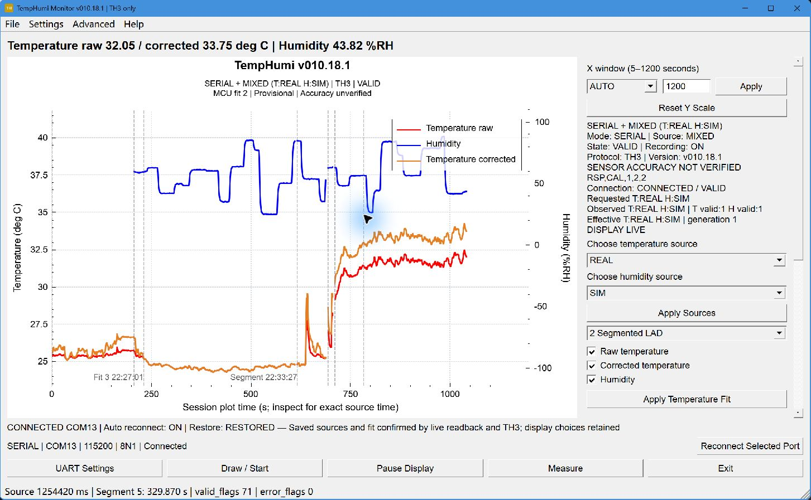

[English](README.md) | [简体中文](README.zh-CN.md) | [日本語](README.ja.md) | [繁體中文](README.zh-TW.md)

# TempHumi Monitor

An STM32F103C8T6 acquisition system with a Qt desktop app for plotting, recording and exporting temperature and humidity data. Each channel explicitly identifies whether its data comes from a REAL input or MCU simulation.

Current release: desktop **v010.18.1** with MCU firmware **v010.17.1**.

*Actual released Qt **v010.18.1**, with MCU firmware **v010.17.1** confirmed over USB UART: **T:REAL / H:SIM**. Blue uses the independent right humidity axis; red raw and orange MCU-corrected temperature share the left axis. The user moved the board from room conditions to near the computer exhaust during this session. Humidity is MCU-simulated, correction is provisional, and this is an interface illustration, not a new accuracy test. Captured about 17 minutes into a 25-minute session; source/fit changes and recovered connection segments remain visible. The [historical v010.15.2 image](docs/release/desktop-showcase.png) and [original v010.18.1 image](docs/release/desktop-v010.18.1.png) are retained; see [capture conditions and provenance](docs/release/PRESENTATION.md).*

## Features

- Original temperature and MCU-corrected temperature, with three **provisional** correction profiles.
- Explicit REAL/SIM selection per channel, including **T:REAL / H:SIM**. A failed REAL channel remains invalid; it never silently switches to SIM.
- OLED and TH3 UART output from the same published measurement snapshot.
- Independent temperature/humidity Y axes, sample and event inspection, and serial, growing-file and REPLAY inputs.
- Exact raw-byte/CSV recording, sidecars and SHA-256-verified full-session export. Pause Display keeps acquisition and recording active; End Session finalizes files and releases COM.
- Bounded reconnect and confirmed-configuration restoration, enabled by default: 5-second intervals, at most 12 attempts, with fresh identity/firmware/readback checks.

## Windows portable and Setup

Download the **portable ZIP** or **Setup** from [Release v010.18.1](https://github.com/HanamiGekka/STM32-TempHumi-Monitor/releases/tag/v010.18.1). The release includes SHA-256 checksums. No development tools are needed to run the packaged app.

1. On Windows 10/11 x64, extract the entire ZIP and run `TempHumi.exe`, or run the **unsigned** Setup. Keep the bundled Qt libraries and plugins beside the EXE.
2. For a connected board, install the appropriate CH340 driver and select its current port in UART Settings: **115200 baud, 8N1, no flow control**.
3. Choose a recording folder and select **Draw / Start**. Startup prepares SERIAL without opening a port. Use **Apply Sources** or **Apply Temperature Fit** to request a change, then check MCU confirmation.

Setup creates Start-menu entries and an optional desktop shortcut. It does not connect to COM or flash firmware. Uninstall retains unowned files and preferences. F1 opens offline Help; About separates desktop/source identity from the observed MCU version.

[Desktop guide](docs/development/DESKTOP.md) · [Hardware evidence](docs/hardware/FINAL_TECHNICAL_AUDIT.md)

## Software architecture

HAL/platform → BSP → Driver → pure Algorithm → Application/source selection → Protocol. OLED and UART share the published values; Qt displays them without recalibrating. The firmware boots in REAL/REAL mode.

Hardware includes STM32F103C8T6, ADS1115, an NTC/U6 temperature path, a CHS1101/TLC556/OPA330 humidity design, OLED and CH340 USB-UART. Design drawings do not establish as-built connectivity.

[Architecture and data-flow diagram](docs/architecture/OVERVIEW.md)

## Acquisition and protocol

TH3 has **23 fields** covering raw codes, units, validity/errors, per-channel sources and generation. Display windows span **5–1200 seconds**, with at most 24,000 displayed points. Display trimming and axis changes do not alter the full raw/CSV record. Left-side zoom/drag controls both temperature curves; right-side zoom/drag controls humidity. Reset Y Scale restores automatic ranges.

[TH3 specification](docs/protocol/TH2_TH3.md) · [UART commands](docs/protocol/UART_COMMANDS.md)

## Testing and validation

The v010.18.1 release acceptance records MCU/Qt Debug and Release builds with zero warnings/errors, 22 host suites, 94 native GUI checks at each of 100%/150% scale, 120 portable checks and 102 bundle checks. Actual installation, Help, recording, serial operation and uninstall/data retention were also checked.

Portable and installed builds each passed the recorded 3600-second host/source-time gates: **3665.000 / 3664.149 s** and **3664.995 / 3664.148 s**, respectively. Retained anomalies and the scope of each result are in the [validation report](docs/release/VALIDATION.md). These are existing release results; this documentation update did not repeat the long tests or rebuild the binaries.

The supplied ten temperature pairs gave raw MAE **0.754 °C** / RMSE **1.020725 °C** and corrected MAE **0.522 °C** / RMSE **0.720777 °C**; corrected maximum absolute error was **1.53 °C**, with **8/10** within ±1 °C. The sample does not establish independent full-range accuracy.

## Build and firmware installation

Validated toolchain: **Qt 5.14.2 / MinGW 7.3 x64**, **STM32CubeIDE 1.19.0 / Arm GCC 13.3**, Python 3 and STM32CubeProgrammer. The [build guide](docs/development/BUILD.md) covers desktop/MCU builds, host checks and SWD programming. Firmware targets 64 KiB Flash / 20 KiB RAM. Before programming, stop acquisition, identify the target, preserve a full Flash backup and verify image provenance; BIN loads at `0x08000000`, followed by Verify and readback comparison.

## Known limitations

- **REAL humidity: PARTIAL / NOT VALIDATED.** SIM humidity does not demonstrate measured RH accuracy.
- **PWM: NOT TESTED ON HARDWARE** for waveform, frequency and duty cycle. **V_CHS1101: CONFLICT** with the follower/ADC DC readings.
- **USB physical root cause: UNRESOLVED.** Successful software recovery does not diagnose the cable, supply or solder joints.
- **Independent full-range temperature accuracy: NOT VERIFIED.** Profiles are provisional; no new optical OLED measurement or second physical Windows PC is claimed.
- **Setup: UNSIGNED.**

## Release and source identity

Desktop **v010.18.1** and MCU **v010.17.1** have separate version identities. The [source/asset mapping](docs/release/SOURCE_IDENTITY.json) identifies the frozen build, reviewed release commit and asset hashes. Fresh builds embed their own checkout/time and do not replace frozen same-version assets. Private history, raw sessions, device identities and account-bearing CAD remain outside the public repository.

## License and credits

Project-authored source and documentation: **GPL-3.0-or-later**. QCustomPlot is by Emanuel Eichhammer; Qt/ST/Arm/MinGW retain their upstream terms. The repository owner is the primary developer; other team members' contributions are acknowledged and they agreed to public release. Qt corresponding-source archives and runtime notices accompany the Release.

[LICENSE](LICENSE) · [NOTICE](NOTICE.md) · [Dependency terms](docs/release/THIRD_PARTY_NOTICES.md)
