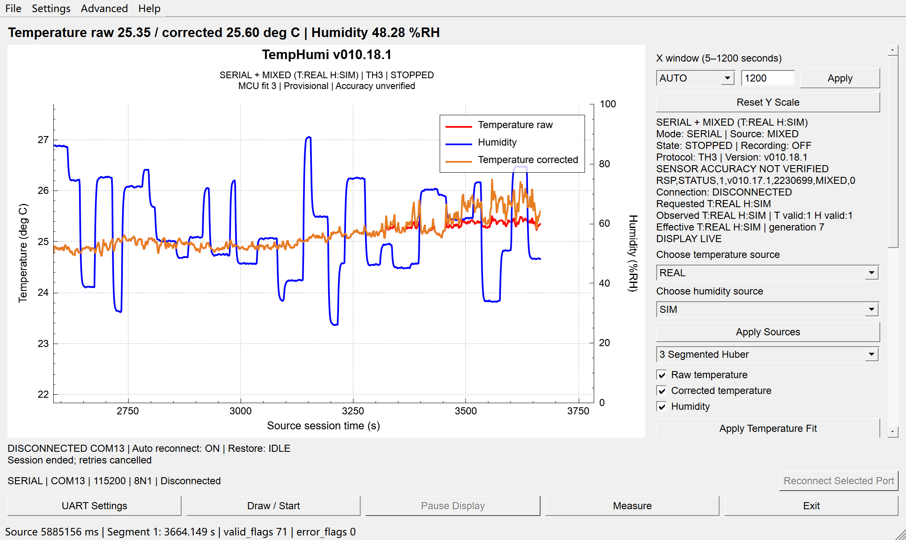

[English](README.md) | [简体中文](README.zh-CN.md) | [日本語](README.ja.md) | [繁體中文](README.zh-TW.md)

# TempHumi Monitor 温湿度监测系统

基于 STM32F103C8T6 的温湿度采集系统，配套 Qt 上位机、显式分通道数据源、原始数据记录及 Windows 便携版和安装版。

桌面版本 **v010.18.1**，MCU 固件 **v010.17.1**。功能运行、模拟数据和独立物理精度分别验证。



## 主要功能

- 真实温度采集与三种**暂定** MCU 温度修正方法；同时保留原始均值与发布值。
- MCU 温度、湿度可分别显式选择 REAL/SIM，支持真实温度加 MCU 模拟湿度；真实故障不会静默转为模拟。
- TH3 串口、增长文件和 REPLAY 输入；独立纵轴、数据点与事件检查、SHA-256 校验的完整 Session 导出。
- 暂停显示不停止记录；结束 Session 完成文件保存并释放串口。F1 为离线帮助，About 区分软件源码身份和实测固件版本。
- 自动重连与已确认配置恢复默认开启，间隔5秒、最多12次；改变配置前核验新鲜设备身份、固件及回读。

## 硬件与运行要求

STM32F103C8T6、ADS1115、NTC/U6 温度调理、CHS1101/TLC556/OPA330 湿度设计、OLED 和 CH340 USB-UART。已验证的 Windows 程序要求 Windows10/11 x64 及适用的 CH340 驱动；烧录使用 ST-Link/SWD。原理图表示设计意图，不等于实物通断验证。

[Hardware evidence](docs/hardware/FINAL_TECHNICAL_AUDIT.md) · [Architecture](docs/architecture/OVERVIEW.md)

## 软件架构

HAL/平台 → BSP → Driver → 纯 Algorithm → Application/数据源选择 → Protocol。OLED 与 UART 使用同一发布语义；Qt 不重新标定。固件启动默认 REAL/REAL。

## 构建与固件烧录

已验证工具为 Qt5.14.2/MinGW7.3x64、STM32CubeIDE1.19.0/Arm GCC13.3、Python3 和 STM32CubeProgrammer。可导入 .project/.cproject 或执行下列命令。烧录前确认目标、供电、镜像来源及采集已关闭，保存完整 Flash 备份；BIN 地址为0x08000000，写入后执行 Verify 并逐字节比较回读。固件适配64KiB Flash/20KiB RAM。

```powershell
python tools/build_desktop.py --configuration both --label verification --build-root build_verify/qt --evidence build_verify/qt_logs
python tools/build_mcu.py --build-root build_verify/mcu --evidence build_verify/mcu_logs
python tools/run_regressions.py --build-root build_verify/tests --evidence build_verify/test_logs --desktop-objects build_verify/qt/qt_debug/debug
```

[Build / flash instructions](docs/development/BUILD.md)

## Windows 便携版与安装版

从 Release 下载便携 ZIP 或未签名 Setup。便携版须完整解压后运行 TempHumi.exe；安装版请选择可写目录，可创建开始菜单及桌面快捷方式。两者使用相同的已验证运行时，安装不会自动连接串口或烧录。卸载保留非安装器拥有的数据及用户设置；不要单独移动 EXE 而遗漏 Qt 库和插件。

[Release](https://github.com/HanamiGekka/STM32-TempHumi-Monitor/releases/tag/v010.18.1) · [Desktop guide](docs/development/DESKTOP.md)

## 采集与通信协议

动态识别实际串口，使用115200/8N1/无流控。启动仅准备 SERIAL，不自动连接；选择记录位置后开始。数据源与温度修正须显式 Apply 并由 MCU 确认。TH3 为23字段，携带原始码、单位、有效性、错误、分通道来源及代次。显示窗口为5–1200秒、最多24000点，原始/CSV记录不受显示裁剪影响。

[TH3](docs/protocol/TH2_TH3.md) · [UART commands](docs/protocol/UART_COMMANDS.md)

## 测试与验证

MCU 与 Qt 的 Debug/Release 全量构建均为零错误、零警告；22项主机回归、100%/150%缩放各94项原生 GUI 检查、120项便携包及102项 Bundle 检查通过。便携版和安装版分别完成超过3600秒的实机记录，主机时间与有效前向源时间均达标；时长、帧数及保留的异常见验证报告。实际安装、帮助、记录、串口及卸载数据保留也已验证。

用户提供的十组温度比较：Raw MAE0.754℃、RMSE1.020725℃；校正后 MAE0.522℃、RMSE0.720777℃，最大绝对误差1.53℃，8/10点位于±1℃。该样本不构成全量程计量精度保证。

[Validation](docs/release/VALIDATION.md)

## 已知限制

- 真实湿度保持 **PARTIAL / NOT VALIDATED**；模拟湿度不能证明真实 RH 精度。
- PWM 波形、频率、占空比 **NOT TESTED**；V_CHS1101 测点近零值与跟随器/ADC 的直流读数仍有矛盾。
- USB 偶发异常的物理根因 **UNRESOLVED**；恢复日志不能证明线缆、供电或焊点故障。
- 温度修正仍为临时性方法；不宣称全量程独立精度、新的 OLED 光学测量或另一台实体 Windows 电脑已验证。

## 发行与源码身份

桌面 v010.18.1 从经审查的公开提交构建；MCU v010.17.1 保持已核验镜像字节。重新构建会嵌入当时提交及时间，不冒充同版本正式替换。独立公开历史通过生产输入哈希、冻结源码和资产 SHA-256 建立对应关系；不包含原始 Session、设备标识、私有历史、Board 照片或含账号信息的 CAD 数据库。

[Source / asset identity](docs/release/SOURCE_IDENTITY.json)

## 许可证与贡献

项目自有源码和文档采用 **GPL-3.0-or-later**；QCustomPlot 作者为 Emanuel Eichhammer，Qt/ST/Arm/MinGW 保留各自条款。仓库所有者是项目主要开发者；其他组员的贡献予以致谢，组员已同意公开发布。Qt 对应源码包与运行时声明随 Release 提供。

[LICENSE](LICENSE) · [NOTICE](NOTICE.md) · [Dependency terms](docs/release/THIRD_PARTY_NOTICES.md)
