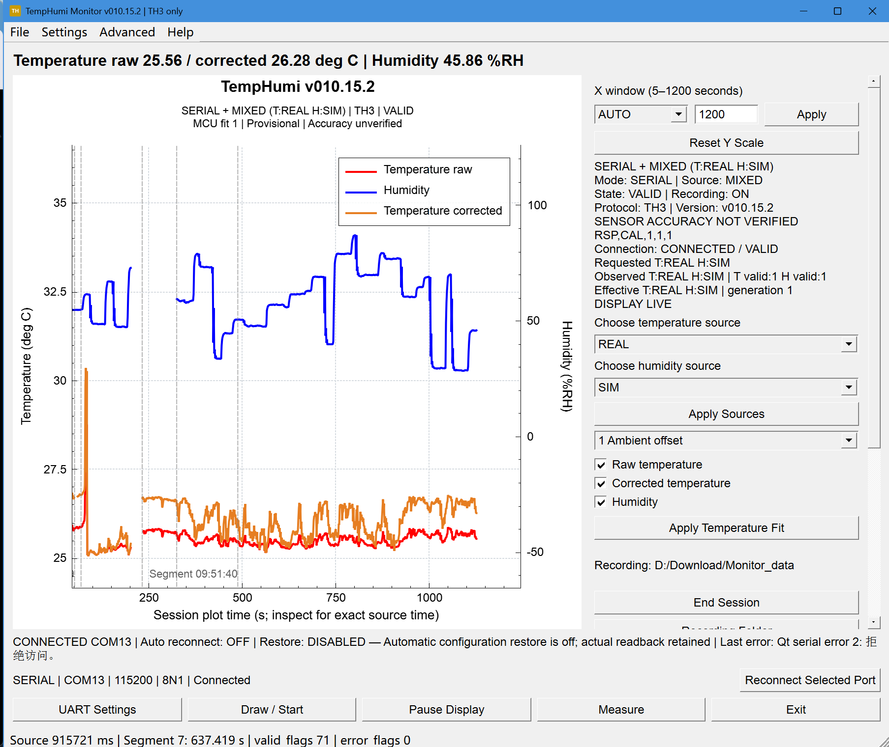

[English](README.md) | [简体中文](README.zh-CN.md) | [日本語](README.ja.md) | [繁體中文](README.zh-TW.md)

# TempHumi Monitor 溫濕度監測系統

以 STM32F103C8T6 擷取資料，搭配 Qt 桌面程式顯示溫濕度曲線、記錄原始資料並匯出。溫度與濕度各自標示 REAL 實際輸入或 MCU SIM 模擬來源。

目前發行：桌面版 **v010.18.1**，MCU 韌體 **v010.17.1**。

*維護者提供的歷史展示圖，介面版本為 v010.15.2。藍色濕度曲線使用右軸，紅色原始溫度與橘色校正溫度共用左軸；圖中濕度由 MCU 模擬。此圖說明顯示配置，不作為 v010.18.1 的新測量證據。[原有 v010.18.1 螢幕截圖](docs/release/desktop-v010.18.1.png)與[圖片來源說明](docs/release/PRESENTATION.md)均保留。*

## 主要功能

- 同時顯示原始溫度與 MCU 校正溫度，提供三種**暫定**修正設定。
- 各通道明確選擇 REAL/SIM，支援 **T:REAL / H:SIM**；真實通道發生故障時維持無效，不會自動改用模擬值。
- OLED 與 TH3 UART 共用同一份已發布的測量快照。
- 溫濕度獨立縱軸、資料點與事件檢視，支援序列埠、持續附加檔案與 REPLAY 輸入。
- 完整記錄原始位元組、CSV 及附屬檔案，匯出帶 SHA-256 驗證的完整工作階段。暫停顯示時仍持續擷取與記錄；結束工作階段後完成儲存並釋放連接埠。
- 自動重新連線與已確認設定還原預設啟用，間隔 5 秒、最多 12 次；還原前核對目前裝置身分、韌體與讀回結果。

## Windows 可攜版與安裝版

從 [Release v010.18.1](https://github.com/HanamiGekka/STM32-TempHumi-Monitor/releases/tag/v010.18.1) 下載**可攜 ZIP** 或 **Setup**，並核對發行頁的 SHA-256。執行發行程式不需要開發工具。

1. 在 Windows 10/11 x64 上完整解壓縮 ZIP 後執行 `TempHumi.exe`，或執行**未簽署**的 Setup。請將 Qt 程式庫與外掛和 EXE 一起保留。
2. 接上板卡時，準備適用的 CH340 驅動程式，在 UART Settings 選擇實際連接埠，使用 **115200 baud、8N1、無流量控制**。
3. 選擇記錄資料夾，按下 **Draw / Start**。啟動僅準備 SERIAL，不自動開啟連接埠。變更資料來源或溫度設定後按對應 Apply，並確認 MCU 回應。

安裝版可建立開始功能表與選用的桌面捷徑，不會自動連線或燒錄。解除安裝會保留非安裝程式擁有的檔案與偏好設定。F1 開啟離線說明，About 分別顯示桌面原始碼身分與實際觀測到的 MCU 版本。

[桌面程式指南](docs/development/DESKTOP.md) · [硬體證據](docs/hardware/FINAL_TECHNICAL_AUDIT.md)

## 軟體架構

HAL／平台 → BSP → Driver → 純演算法 → Application／資料來源選擇 → Protocol。OLED 與 UART 共用發布值，Qt 負責顯示，不再次校正。韌體啟動預設為 REAL/REAL。

硬體設計包含 STM32F103C8T6、ADS1115、NTC/U6 溫度鏈路、CHS1101/TLC556/OPA330 濕度鏈路、OLED 與 CH340 USB-UART。設計圖不能代替實體導通檢查。

[架構與資料流圖](docs/architecture/OVERVIEW.md)

## 擷取與通訊協定

TH3 包含 **23 個欄位**，傳送原始碼值、單位、有效性、錯誤、各通道來源與世代。顯示視窗為 **5–1200 秒**，最多 24,000 個點；顯示裁切與座標軸調整不影響完整的原始／CSV 記錄。左半區縮放與平移控制兩條溫度曲線，右半區控制濕度；Reset Y Scale 還原自動範圍。

[TH3 協定](docs/protocol/TH2_TH3.md) · [UART 指令](docs/protocol/UART_COMMANDS.md)

## 測試與驗證

v010.18.1 發行驗收記錄了 MCU／Qt Debug 與 Release 零警告、零錯誤建置，以及 22 套主機回歸、100%／150% 縮放各 94 項原生 GUI 檢查、120 項可攜套件與 102 項 Bundle 檢查；實際安裝、說明、記錄、序列埠與解除安裝時的資料保留也已驗證。

可攜版與安裝版分別通過 3600 秒主機／前進來源時間門檻，時長為 **3665.000／3664.149 秒**與 **3664.995／3664.148 秒**。各項證據範圍和保留異常見[驗證報告](docs/release/VALIDATION.md)。這些是既有發行結果，本次文件維護未重複長時間測試或重新建置二進位檔。

提供的十組溫度對照：原始 MAE **0.754 °C**、RMSE **1.020725 °C**；校正後 MAE **0.522 °C**、RMSE **0.720777 °C**，最大絕對誤差 **1.53 °C**，**8/10** 在 ±1 °C 內。此樣本不能證明獨立全量程精度。

## 建置與韌體燒錄

已驗證工具鏈為 **Qt 5.14.2／MinGW 7.3 x64**、**STM32CubeIDE 1.19.0／Arm GCC 13.3**、Python 3 與 STM32CubeProgrammer。[建置指南](docs/development/BUILD.md)提供桌面程式、MCU、主機檢查與 SWD 燒錄步驟。韌體目標為 64 KiB Flash／20 KiB RAM。燒錄前停止擷取、確認目標與映像來源、保存完整 Flash 備份；BIN 起始位址為 `0x08000000`，接著執行 Verify 與讀回比較。

## 已知限制

- **REAL 濕度：PARTIAL / NOT VALIDATED**。SIM 濕度不能代表真實 RH 精度。
- **PWM：NOT TESTED ON HARDWARE**，缺少波形、頻率與工作週期實測；**V_CHS1101：CONFLICT**，與跟隨器／ADC 直流讀值仍有矛盾。
- **USB 物理根因：UNRESOLVED**。軟體復原成功不能證明線材、供電或焊點的具體原因。
- **獨立全量程溫度精度：NOT VERIFIED**。溫度設定仍為暫定，不宣稱新的 OLED 光學測量或第二台實體 Windows 電腦驗收。
- **Setup：UNSIGNED（未簽署）**。

## 發行與原始碼身分

桌面 **v010.18.1** 與 MCU **v010.17.1** 分別標示版本。[原始碼與資產對應關係](docs/release/SOURCE_IDENTITY.json)記錄凍結建置、公開發行提交與資產雜湊。重新建置會嵌入當時提交及時間，不取代同版本凍結資產。私有歷史、原始工作階段、裝置識別資訊與含帳號資訊的 CAD 不納入公開儲存庫。

## 授權條款與貢獻

專案原創原始碼及文件採 **GPL-3.0-or-later**。QCustomPlot 作者為 Emanuel Eichhammer；Qt／ST／Arm／MinGW 保留上游條款。儲存庫擁有者為主要開發者，其他組員的貢獻予以致謝，並已同意公開。Qt 對應原始碼套件與執行階段聲明隨 Release 提供。

[LICENSE](LICENSE) · [NOTICE](NOTICE.md) · [相依套件條款](docs/release/THIRD_PARTY_NOTICES.md)
